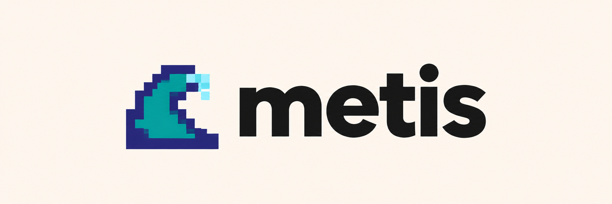
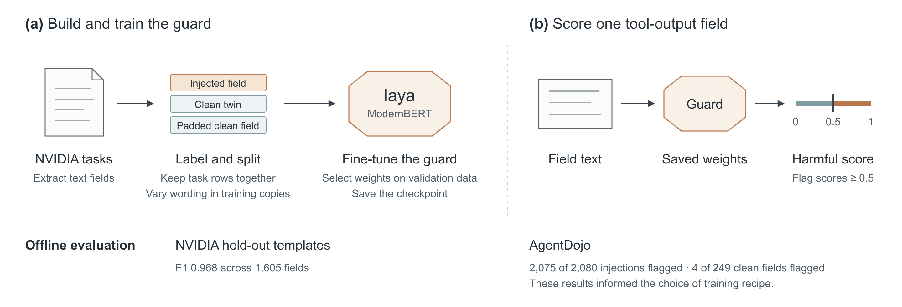

  

# Metis

Metis detects injected instructions in tool output. It scores each text field and flags scores of 0.5 or higher.

## Architecture

[Hugging Face model](https://huggingface.co/RRL-dev/metis) · [Model card and results](docs/model.md) · [SVG](docs/assets/architecture.svg) · [PDF](docs/assets/architecture.pdf)

## Results

| Benchmark | Model | Injected fields detected (recall) | Clean fields flagged | Precision | F1 |
|---|---|---:|---:|---:|---:|
| NVIDIA held-out templates | Base laya | 49 / 288 (17.01%) | 4 / 1,317 (0.30%) | 92.45% | 0.287 |
| NVIDIA held-out templates | Trained Metis | 288 / 288 (100%) | 19 / 1,317 (1.44%) | 93.81% | 0.968 |
| AgentDojo | Base laya | 1,799 / 2,080 (86.49%) | 4 / 249 (1.61%) | 99.78% | 0.927 |
| AgentDojo | Trained Metis | 2,075 / 2,080 (99.76%) | 4 / 249 (1.61%) | 99.81% | 0.998 |

We used AgentDojo results to choose the training recipe.

## Quick start

Install the dependencies with `make sync`. The first run downloads the data or model needed for each command.

| Task | Command | Output |
|---|---|---|
| Explore AgentDojo tasks offline | `make viewer` | `resources/data/dojo/index.html` |
| Explore NVIDIA tasks offline | `make nvidia-tasks` | `resources/data/nvidia/index.html` |
| Try a small training run | `make train TRAIN="epochs=1 limit=200"` | Checkpoint and metrics under `resources/runs/` |
| Evaluate a saved guard on AgentDojo | `make evaluate EVAL="base=RRL-dev/metis name=dojo"` | Field predictions and metrics under `resources/runs/` |

For a local checkpoint, set `base` to its directory. Run `make check` for formatting, linting, type checks, and tests.
